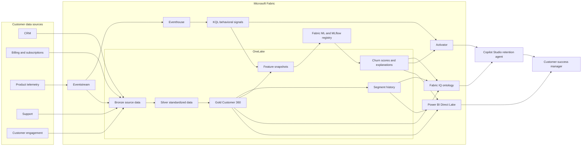

# Customer Pulse 360

## An Explainable, Real-Time Customer Retention System Built on Microsoft Fabric

**Hackathon blueprint submission**

[Read the detailed technical blueprint](technical-blueprint.md)

## Scenario blueprints website

The interactive scenario document is in [site/index.html](../../site/index.html). Open this file in a browser for a local preview.

The `Deploy scenario blueprints to GitHub Pages` workflow publishes only `site/`. It runs on pushes to `main` and through `workflow_dispatch`. Manual runs deploy only the `main` branch.

A repository administrator must enable GitHub Pages with **GitHub Actions** as the source under **Settings > Pages**. Private repositories require a GitHub plan that supports Pages. A Pages site can be public even when its source repository is private. Confirm the intended audience before enabling publication. Do not add credentials or customer records to `site/`.

After a successful deployment, the workflow environment shows the site URL. Update `site/index.html` and push to `main` to publish subsequent changes.

---

## Executive summary

Customer churn rarely begins with a cancellation. It begins weeks or months earlier through declining product adoption, unresolved support issues, failed customer journeys, reduced engagement, and approaching renewal dates. These warning signs are usually distributed across CRM, billing, product telemetry, customer-success, and support platforms. By the time they are assembled into a report, the opportunity to intervene may already have passed.

**Customer Pulse 360** is a Microsoft Fabric blueprint that converts fragmented customer data into an explainable and actionable early-warning system. It creates a governed Customer 360 in OneLake, continuously analyzes customer journeys through Eventstream and Eventhouse, predicts churn over a three-month horizon, and uses Activator with a Copilot Studio agent to deliver an evidence-backed retention brief to the responsible customer-success manager.

The solution does more than generate a risk score. It answers five operational questions:

1. **Who is the customer?**
2. **What has changed in their behavior?**
3. **How likely are they to churn within three months?**
4. **Why has the model reached that conclusion?**
5. **What approved action should a human take next?**

The result is a closed-loop retention capability:

```text
Resolve identity → Understand behavior → Predict risk
→ Explain the warning → Recommend action → Measure the outcome
```

---

## 1. The challenge

Organizations hold valuable customer signals, but those signals are rarely connected:

- CRM contains account ownership and customer contacts.
- Billing platforms contain subscriptions, recurring revenue, and renewal dates.
- Product telemetry reveals adoption and declining usage.
- Support platforms reveal unresolved incidents and recurring friction.
- Customer-success systems contain meetings, playbooks, and engagement history.

This fragmentation creates four problems:

### Incomplete customer identity

One organization can appear under several names, domains, subsidiaries, billing accounts, or contact records. Without documented identity resolution, analytics can double-count customers or attribute behavior to the wrong account.

### Delayed warning signals

Batch reporting can identify churn risk after the most important behavior has already changed. Product and support events need to be evaluated as they occur and compared with the customer's historical baseline.

### Opaque predictions

A risk score alone does not tell a customer-success manager what happened or what to do. Operational adoption requires evidence, explanations, and traceability.

### Disconnected action

Dashboards describe risk but often leave the intervention outside the data platform. This breaks the link between detection, action, and measured outcome.

---

## 2. Proposed solution

Customer Pulse 360 uses Microsoft Fabric as the unified data, analytics, AI, and action platform.

The solution combines:

- **OneLake and Lakehouse** for governed customer data.
- **Fabric Data Factory pipelines** for scheduled ingestion and transformation.
- **Fabric IQ ontology** for shared business meaning.
- **Eventstream and Eventhouse** for real-time customer journeys.
- **KQL** for longitudinal behavioral signals.
- **Fabric Data Science and MLflow** for churn modeling and registration.
- **Activator** for event-driven early warnings.
- **Copilot Studio** for an evidence-grounded retention agent.
- **Power BI Direct Lake** for low-latency portfolio and account reporting.
- **Microsoft Purview** for classification, sensitivity labels, lineage, and governance.

### Target architecture



---

## 3. Solution experience

Consider a high-value customer whose renewal is due in 67 days.

During the previous month:

- Weekly active usage falls by 46%.
- Adoption of a strategic feature has stalled.
- Two high-severity support cases remain unresolved.
- A critical workflow repeatedly fails.
- Engagement with the customer-success team has reduced.

Eventstream captures the latest product activity and sends it to Eventhouse. KQL compares current behavior with the account's historical baseline and emits persistent behavioral signals. The next scoring run raises the account's three-month churn probability from 31% to 82%.

The model does not return an unexplained number. It provides ranked account-level feature attributions. Activator recognizes that the score exceeds the approved risk threshold and that the account's value and renewal proximity make it eligible for intervention.

The Copilot Studio agent receives governed context through the customer ontology and produces a structured retention brief:

> **Risk:** High — 82% probability of churn or material contraction within three months
> **Value at risk:** £420,000 recurring revenue
> **Why:** Usage declined 46%; two critical support cases remain open; renewal is due in 67 days
> **Recommended action:** Escalate the open incident, schedule an adoption review within three business days, and prepare a renewal recovery plan
> **Evidence:** Links to the relevant behavioral signals, support records, model version, and scoring timestamp

The customer-success manager reviews and approves the action. The decision and eventual outcome are retained, creating a feedback loop for model evaluation and playbook improvement.

---

## 4. Core capabilities

### 4.1 Resolved Customer 360

The Gold customer table contains one current row per canonical account, supported by separate contact, subscription, interaction, support, score, and segment entities.

Identity resolution follows a documented hierarchy:

| Priority | Evidence | Decision |
|---|---|---|
| 1 | Trusted mastered account or cross-reference ID | Automatic match |
| 2 | Verified billing account ID | Automatic match |
| 3 | Exact legal name and exact company registration identifier | Automatic match |
| 4 | Verified corporate domain, compatible country, and organization name | High-confidence automatic match |
| 5 | Exact address and strong fuzzy organization-name agreement | Threshold-based match |
| 6 | Contact overlap plus compatible account evidence | Probabilistic candidate |
| 7 | Name-only, domain-only, or address-only evidence | Review or reject |

Trusted identifier conflicts prevent automatic linking. Parent and subsidiary accounts are represented through account hierarchy rather than incorrectly merged.

Every source-to-canonical link records:

- Source system and source record
- Match method and rule
- Match score
- Supporting evidence
- Resolution version
- Resolution timestamp
- Human review outcome, where applicable

The match-quality report measures coverage, automatic-match rate, review rate, unresolved records, estimated precision, duplicate reduction, cluster stability, and rule-level performance.

### 4.2 Fabric IQ customer ontology

The ontology creates shared business meaning across analytics and agents.

Its main entities are:

- Account
- Contact
- Subscription
- Interaction
- Support event
- Usage signal
- Segment
- Churn assessment
- Retention action

Relationships connect each account to its contacts, subscriptions, interactions, support history, behavioral signals, segments, model assessments, and interventions.

Ontology properties bind to governed Gold and Silver OneLake tables rather than raw data. Personal properties are classified and exposed only to authorized experiences. This enables consistent questions such as:

- Which high-value accounts renew in the next 90 days and show sustained usage decline?
- Which unresolved support issues contribute to the highest-risk assessments?
- Why did this account enter the intervention segment this week?
- Which recommended retention actions remain incomplete?

### 4.3 Real-time customer journey

Product and interaction events use a common envelope:

```text
event_id
event_type
event_time
account_id or resolvable source identifier
contact_id
subscription_id
session_id
product_area
properties
schema_version
producer
```

Eventstream validates and routes events to Eventhouse for low-latency analysis and to OneLake for durable history and replay. Invalid events are quarantined rather than silently discarded.

KQL derives at least three longitudinal signals:

#### Sustained usage decline

Compares the current seven-day activity with the preceding four-week baseline and detects a material fall only when sufficient baseline activity exists.

#### Adoption stall

Identifies eligible accounts that use the core product but have not adopted a strategic feature by the expected tenure point.

#### Support-friction escalation

Detects an increase in severe, repeated, reopened, or long-running support issues relative to the account's prior baseline.

Additional signals include engagement silence and repeated failed outcomes.

Each signal stores the account, signal type, observation window, baseline, observed value, threshold version, severity, evidence, and detection time.

### 4.4 Dynamic, auditable segmentation

Segment definitions are stored as governed, versioned configuration. Initial operational segments include:

- High risk, high value, renewal within 90 days
- Product-adoption stalled
- Support friction escalating
- Engagement recovery opportunity
- New-customer onboarding risk
- Healthy advocate
- Insufficient evidence

A scheduled pipeline evaluates definitions and writes membership using a Type 2 history pattern. Every membership records its definition version, supporting evidence, validity period, and pipeline run.

This makes it possible to answer not only *which segment is the account in now?* but also *which segment was it in at a previous date, why did it enter, and which rule version made that decision?*

### 4.5 Explainable churn model

The model predicts churn or material contraction within the next three months at canonical-account level.

Feature families include:

- Contract tenure, value, and renewal proximity
- Product adoption, activity trend, breadth, and volatility
- Reliability and failed customer journeys
- Support severity, frequency, reopen rate, and age
- Customer engagement and response recency
- Commercial and payment behavior
- Behavioral-signal persistence and severity

Time-based train, validation, and held-out test periods prevent future information from leaking into training. Candidate runs record the data snapshot, feature schema, parameters, code version, split dates, and metrics in MLflow.

The held-out evaluation includes:

- Accuracy
- Precision, recall, and F1 at the operational threshold
- PR-AUC and ROC-AUC
- Confusion matrix
- Lift and cumulative gains by risk decile
- Calibration
- Performance across appropriate business cohorts

The production threshold is selected according to intervention capacity and the relative cost of missed churn versus unnecessary outreach—not accuracy alone.

Local feature attributions are generated for each scored account and translated into business-readable reason codes. These explanations describe model behavior and are not presented as proof of causation.

### 4.6 Agentic early warning

Activator monitors churn assessments and severe behavioral signals. A warning is created when:

- Risk exceeds the approved threshold.
- Value at risk exceeds the operational floor.
- The account is eligible for outreach.
- No equivalent open alert exists.

Deduplication, cooldown periods, and escalation rules prevent alert fatigue.

The Copilot Studio agent retrieves only governed ontology context and approved retention playbooks. It produces a structured brief containing:

- Risk score and band
- Three-month horizon
- Value at risk
- Top evidence-backed reasons
- Recent customer journey
- Renewal and support context
- Recommended actions
- Responsible owner
- Evidence links
- Model and prompt versions

The agent can draft a call plan, email, support escalation, adoption workshop, or success-plan task. Customer communications and material commercial decisions require human approval.

### 4.7 Direct Lake decision dashboard

The Power BI Direct Lake model presents:

1. **Executive overview** — risk, value at risk, trend, and intervention coverage.
2. **At-risk portfolio** — ranked accounts, renewal dates, owners, segments, risk, value, and reasons.
3. **Account journey** — usage, support, engagement, score trend, explanations, and interventions.
4. **Segment movement** — entries, exits, historical membership, and outcomes.
5. **Model and data quality** — lift, calibration, drift, identity quality, and freshness.
6. **Intervention outcomes** — alerts, approvals, actions, resolution time, and retained value.

Row-level security restricts customer portfolios by owner or region. Personal fields use object-level security or a separate secured semantic model where required.

---

## 5. What makes the solution distinctive

### A closed-loop system rather than another dashboard

The solution connects observation, prediction, explanation, intervention, and outcome measurement. Most churn solutions stop at reporting or scoring; Customer Pulse 360 makes the prediction operational.

### Customer-specific behavioral baselines

Signals compare each account with its own longitudinal behavior. This is more meaningful than applying one static activity threshold to customers with different sizes, products, and expected usage patterns.

### Explanation before automation

An alert contains model evidence, recent behavior, source lineage, and approved next actions. The agent does not create unsupported explanations from an opaque score.

### Identity and governance by design

Customer identity, personal-data classification, permissions, lineage, historical audit, and human approval are foundational components—not activities postponed until production.

### One Fabric experience

The architecture demonstrates how OneLake, Data Factory, Fabric IQ, Real-Time Intelligence, Data Science, Activator, Power BI, Copilot Studio, and Purview can form one coherent business solution.

---

## 6. Governance and responsible AI

The solution applies the following controls:

- Data minimization in Gold tables, prompts, reports, and agent responses
- Purview classification and sensitivity labels for personal data
- Least-privilege managed identities and role-based access
- Row-level and object-level security
- Source-to-report and source-to-agent lineage
- Versioned identity rules, segment definitions, features, models, prompts, and playbooks
- Human approval before external communications or commercial decisions
- Evidence links and timestamps for agent-generated claims
- Monitoring for data drift, model drift, cohort performance, and alert outcomes
- Audit records for model scoring, alert creation, agent retrieval, approval, action, and outcome

Protected characteristics and unjustified proxies are excluded from model features. A responsible-AI review is required before production use.

Sensitivity labels complement rather than replace access control, encryption, retention, consent management, and data minimization.

---

## 7. Measurable success

The blueprint proposes evaluation across four dimensions.

### Data trust

- Percentage of active source records assigned to a canonical account
- Reviewed precision of automatic identity matches
- Duplicate reduction and cluster stability
- Data freshness and contract compliance

### Predictive performance

- Precision and recall at the intervention threshold
- Lift in the highest-risk deciles
- Calibration
- Performance by appropriate customer cohorts

### Operational performance

- Time from qualifying event to behavioral signal
- Time from risk assessment to alert
- Alert acceptance and completion rates
- Customer-success response time
- Duplicate and suppressed-alert rates

### Business performance

- Value at risk reviewed
- Renewal or retention rate among contacted accounts
- Incremental retention relative to an approved comparison method
- Revenue protected
- Intervention cost and return

A transparent scenario can estimate potential value:

```text
Potential protected revenue
= Value at risk
× Alert precision
× Successful intervention rate
```

All forecast values are labeled as assumptions until validated through controlled production measurement.

---

## 8. Delivery plan

| Phase | Scope | Exit evidence |
|---|---|---|
| 1. Discover | Confirm sources, owners, contracts, churn definition, intervention capacity, privacy requirements | Approved decisions and data contracts |
| 2. Unify | Build Bronze/Silver ingestion, identity resolution, Gold Customer 360, and match-quality reporting | Reconciliation and reviewed match results |
| 3. Understand | Publish ontology, Eventstream/Eventhouse path, KQL journeys, and behavioral signals | Competency-query and signal tests |
| 4. Predict | Create feature snapshots, train and evaluate the churn model, register the approved version, generate attributions | Held-out report and model card |
| 5. Act | Configure segmentation, Activator, retention agent, approvals, and feedback capture | End-to-end alert and audit test |
| 6. Operate | Publish Direct Lake reporting, apply Purview controls, monitor quality and drift | Security, lineage, performance, and operational sign-off |

The implementation is designed for development, test, and production workspaces using deployment pipelines and environment-specific configuration.

---

## 9. Blueprint acceptance criteria

The solution is considered complete when it provides:

1. A resolved Customer 360 Gold table with documented identity rules, source lineage, stewardship handling, and a match-quality report.
2. A published Fabric IQ ontology connecting accounts, contacts, subscriptions, interactions, support events, signals, segments, assessments, and actions to governed OneLake sources.
3. A working Eventstream-to-Eventhouse path with journey queries and at least three persisted longitudinal behavioral signals.
4. Scheduled dynamic segmentation with versioned definitions and historically reconstructable membership.
5. A registered Fabric ML churn model with held-out accuracy, precision, recall, lift, calibration, and account-level feature attributions.
6. An Activator and Copilot Studio workflow producing a scored, explained, evidence-linked, and actionable retention brief with human approval.
7. A Power BI Direct Lake dashboard for three-month account risk, with appropriate Purview labels, permissions, lineage, and audit controls.

---

## 10. Feasibility and assumptions

The architecture uses native Microsoft Fabric capabilities and deliberately separates low-latency event analysis from scheduled analytical and machine-learning workloads.

The following must be confirmed before production implementation:

- Source-system availability and data quality
- Exact legal and commercial churn definition
- Event volumes, latency, ordering, retention, and replay requirements
- Fabric capacity, licensing, region, and tenant settings
- Availability and production policy for any preview capabilities
- Identity thresholds and stewardship capacity
- Customer-success intervention capacity
- Approved retention actions and playbooks
- Personal-data, residency, retention, and consent requirements

These dependencies do not prevent a representative prototype using synthetic customer and event data.

---

## Conclusion

Customer Pulse 360 transforms disconnected customer records into an operational retention capability.

Its value is not simply that it predicts churn. It establishes who the customer is, recognizes meaningful changes in their journey, explains the resulting risk, recommends a governed response, and records whether that response worked.

By combining the data, real-time, semantic, machine-learning, agentic, reporting, and governance capabilities of Microsoft Fabric, the blueprint provides a credible path from fragmented signals to timely human action:

> **Know the customer. Detect the change. Explain the risk. Act before the renewal is lost.**
