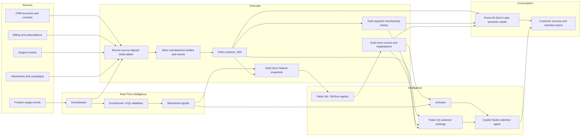

# Customer 360 and Churn Early-Warning Blueprint

## 1. Purpose

This blueprint defines a Microsoft Fabric implementation for a governed Customer 360, real-time behavioral intelligence, dynamic segmentation, churn prediction, agentic intervention, and Direct Lake reporting.

The design covers seven outcomes:

1. A resolved Customer 360 Gold table with explicit identity-resolution rules and match-quality reporting.
2. A Fabric IQ customer ontology bound to OneLake sources.
3. An Eventstream-to-Eventhouse path with KQL journey analysis and behavioral signals.
4. Auditable, schedule-driven dynamic segmentation.
5. A registered churn model with held-out evaluation and account-level explanations.
6. An Activator and Copilot Studio early-warning workflow.
7. A Power BI Direct Lake dashboard with Purview protection for personal data.

This is a platform blueprint, not evidence that the solution has been deployed. Workspace names, source-system identifiers, thresholds, retention periods, owners, and service-level objectives must be confirmed during discovery.

## 2. Target outcomes and success measures

| Outcome | Proposed acceptance measure |
|---|---|
| Trusted customer identity | At least 95% of active source records assigned to a canonical account; no unresolved duplicate cluster above the agreed value/risk threshold |
| Explainable matching | Every linked record stores rule/model version, match method, confidence, evidence, and resolution timestamp |
| Fresh customer intelligence | Batch Customer 360 and segments meet the agreed pipeline SLA; streaming signals become queryable within the agreed real-time SLA |
| Auditable decisions | Historical segment membership, model versions, scores, explanations, alerts, and agent recommendations are reproducible |
| Useful churn prediction | Model beats the agreed baseline on held-out data and demonstrates lift in the top risk deciles |
| Actionable intervention | Every alert includes risk, reasons, recent behavior, customer context, recommended action, owner, and feedback state |
| Governed access | Personal data is labeled, access controlled, lineage visible, and excluded from prompts unless explicitly required and authorized |

Suggested initial service targets are a 4-hour batch SLA, under 2 minutes for streaming signal availability, and under 5 minutes from qualifying signal to alert. These are starting points for stakeholder agreement, not fixed platform guarantees.

## 3. Logical architecture



### Recommended workspace separation

Use development, test, and production workspaces with Fabric deployment pipelines. Separate restricted customer data from broadly accessible analytics where organizational policy requires it.

| Workspace domain | Primary contents |
|---|---|
| Data foundation | Lakehouse, shortcuts/mirroring, ingestion pipelines, quality outputs |
| Real-time intelligence | Eventstream, Eventhouse, KQL database, Activator |
| Data science | Feature tables, experiments, registered models, scoring notebooks/jobs |
| Semantic and BI | Fabric IQ ontology, semantic model, reports |
| Agentic operations | Approved connectors, agent topics/actions, retention workflow |

## 4. Data foundation and contracts

### Core business keys

- `account_id`: immutable canonical identifier generated by the Customer 360 process.
- `contact_id`: immutable canonical person identifier.
- `source_system` and `source_record_id`: immutable source lineage pair.
- `subscription_id`: billing-system subscription identifier.
- `event_id`: globally unique event identifier for idempotent streaming ingestion.
- `event_time`: producer timestamp in UTC.
- `ingested_at`: Fabric ingestion timestamp in UTC.
- `effective_from` and `effective_to`: history validity timestamps.

### Medallion tables

**Bronze**

- Preserve source payloads, source keys, ingestion metadata, and schema version.
- Append rather than overwrite except where source replication technology owns change capture.
- Quarantine malformed records without silently discarding them.

**Silver**

- Standardize email, phone, address, organization name, country, currency, timestamps, and consent.
- Deduplicate within each source before cross-source resolution.
- Conform interaction and usage events to a shared event envelope.
- Apply quality rules and publish reject reason codes.

**Gold**

- `gold.customer_360`
- `gold.customer_identity_link`
- `gold.identity_match_quality`
- `gold.segment_definition`
- `gold.segment_membership_history`
- `gold.churn_feature_snapshot`
- `gold.churn_score`
- `gold.churn_explanation`
- `gold.retention_action`

All Gold tables should use Delta format. Personal fields should be minimized in Gold and exposed through secured views when operational use requires them.

## 5. Workstream 1: Customer 360 identity resolution

### Canonical grain

`gold.customer_360` has one current row per canonical account. Use a separate contact entity rather than flattening all people onto the account row. Keep source lineage in `gold.customer_identity_link`.

Recommended account fields:

- Canonical identifiers and preferred display name
- Account lifecycle status, region, industry, and owner
- Contract value, recurring revenue, tenure, renewal date, and subscription summary
- Aggregated 7/30/90-day usage and support measures
- Current segment and churn risk band
- Data quality, identity confidence, and last-refreshed timestamps

### Resolution sequence

1. Normalize candidate attributes without destroying original values.
2. Deduplicate records inside each source.
3. Generate candidate pairs using blocking keys to avoid all-to-all comparison.
4. Apply deterministic rules in priority order.
5. Score remaining candidates using an approved probabilistic matcher.
6. Cluster links into canonical accounts while preventing contradictory identifiers.
7. Route ambiguous or high-value conflicts to stewardship.
8. publish canonical entities, links, and quality metrics atomically.

### Initial identity rules

| Priority | Rule | Result | Confidence |
|---|---|---|---|
| 1 | Existing trusted cross-reference or mastered account ID agrees | Auto-link | 1.00 |
| 2 | Verified billing account ID agrees | Auto-link | 0.99 |
| 3 | Exact normalized legal name and exact tax/company registration ID | Auto-link | 0.99 |
| 4 | Exact verified corporate domain plus compatible country and name | Auto-link unless domain is generic/shared | 0.95 |
| 5 | Exact normalized address plus fuzzy organization-name agreement | Auto-link above approved score | 0.90-0.97 |
| 6 | Contact email/phone overlap plus compatible account evidence | Candidate; link only above approved score | Model score |
| 7 | Name-only, domain-only, or address-only evidence | Never sufficient alone | Review/reject |

Hard constraints should block a link when trusted tax IDs conflict, countries are incompatible under business rules, or one-to-one source identifiers would be violated. Subsidiary-to-parent relationships must be represented as account hierarchy, not resolved as duplicates.

### Link audit schema

`gold.customer_identity_link` should include:

```text
account_id
source_system
source_record_id
match_status
match_method
match_rule_id
match_score
evidence_json
resolution_version
resolved_at
resolved_by
review_case_id
```

### Match-quality report

Report by source, region, account tier, and resolution version:

- Coverage: records assigned to a canonical entity
- Auto-match, review, unresolved, and rejected rates
- Precision estimate from a stratified reviewed sample
- Duplicate rate before and after resolution
- Cluster-size distribution and suspiciously large clusters
- Rule-level match volume and reviewed precision
- Stability: changed canonical assignments since the prior run
- Missingness and validity for high-value match attributes
- False-positive and false-negative review outcomes

Do not use the match score as a claimed probability unless it has been calibrated and validated as such.

## 6. Workstream 2: Fabric IQ customer ontology

### Ontology entities

| Entity | Key | Important relationships |
|---|---|---|
| Account | `account_id` | has contacts, subscriptions, interactions, support events, scores, segments |
| Contact | `contact_id` | belongs to account; participates in interactions |
| Subscription | `subscription_id` | belongs to account; covers products/plans |
| Interaction | `interaction_id` | concerns account/contact; occurs through channel |
| SupportEvent | `support_event_id` | raised by account/contact; affects product/subscription |
| UsageSignal | composite signal key | observed for account/subscription over a time window |
| Segment | `segment_id` | classifies accounts through versioned membership |
| ChurnAssessment | score key | assesses account for horizon and model version |
| RetentionAction | `action_id` | responds to an assessment or signal |

### Binding principles

- Bind ontology properties to governed Gold or Silver OneLake tables, not raw Bronze payloads.
- Use canonical IDs for joins and expose source IDs only as lineage properties.
- Define business names, descriptions, synonyms, units, valid values, and ownership.
- Encode account hierarchy separately from duplicate identity.
- Mark personal properties explicitly and restrict their use by agents.
- Version ontology mappings with source schemas and semantic model releases.
- Test representative natural-language questions and multi-hop relationships before publication.

Example competency questions:

- Which enterprise accounts renew in the next 90 days and show falling weekly active use?
- Which open high-severity support cases contribute to the top-risk churn assessments?
- Which customer-success owner has the greatest recurring revenue in the high-risk/no-contact segment?
- Why did a named account move into the intervention segment this week?

### Publication evidence

- Published ontology version and owner
- Entity/property/relationship catalog
- OneLake binding map with workspace, item, table, and column
- Security classification for each exposed property
- Validation results for competency questions
- Lineage screenshot/export and release record

Fabric IQ ontology capabilities may be preview features. Confirm tenant availability, regional support, licensing, API stability, and production support policy before making the ontology a critical runtime dependency.

## 7. Workstream 3: Real-time journey intelligence

### Eventstream path

Product and digital interaction producers send events with:

```text
event_id, event_type, event_time, account_id or resolvable_source_id,
contact_id, subscription_id, session_id, product_area, properties,
schema_version, producer
```

Eventstream performs lightweight validation, routing, and enrichment. It writes events to:

- Eventhouse for low-latency KQL analysis and signal generation.
- A Bronze Delta destination for durable replay and longitudinal feature engineering.
- A dead-letter/quarantine destination for invalid or unresolvable events.

Eventhouse tables should define ingestion mappings, retention, caching, partitioning, update policies/materialized views where justified, and monitoring for lag, failures, duplicates, and schema drift.

### Journey query

```kusto
let lookback = 30d;
CustomerEvents
| where EventTime >= ago(lookback)
| where isnotempty(AccountId)
| order by AccountId asc, EventTime asc
| serialize
| extend PreviousEventTime = prev(EventTime),
         PreviousAccount = prev(AccountId)
| extend MinutesSincePrevious =
    iff(AccountId == PreviousAccount,
        datetime_diff("minute", EventTime, PreviousEventTime),
        long(null))
| project AccountId, EventTime, EventType, ProductArea, SessionId,
          MinutesSincePrevious
```

For production journey analysis, sessionize by an agreed inactivity threshold and encapsulate repeated logic in governed KQL functions.

### Behavioral signals

At least three signals are required; the recommended initial set contains five:

**1. Sustained usage decline**

```kusto
let current =
    CustomerEvents
    | where EventTime between (ago(7d) .. now())
    | summarize CurrentEvents=count() by AccountId;
let baseline =
    CustomerEvents
    | where EventTime between (ago(35d) .. ago(7d))
    | summarize BaselineWeeklyEvents=count()/4.0 by AccountId;
current
| join kind=inner baseline on AccountId
| extend DeclinePct =
    100.0 * (BaselineWeeklyEvents - CurrentEvents)
    / max_of(BaselineWeeklyEvents, 1.0)
| where BaselineWeeklyEvents >= 10 and DeclinePct >= 40
```

**2. Adoption stall**

Flag accounts with meaningful core use but no first use of a strategic feature by an agreed tenure point. Compare eligible features by plan so unavailable features never count against the customer.

**3. Support-friction escalation**

Detect a rising 30-day count of high-severity tickets, reopen events, or repeated incidents in the same product area relative to the preceding 90-day baseline.

**4. Engagement silence**

Detect active, paid accounts with no qualifying product activity or customer-success interaction for an agreed number of days, adjusted for contract type and expected usage cadence.

**5. Failed outcome loop**

Detect repeated error, cancellation, rollback, or abandoned workflow sequences within a rolling window.

Each emitted signal should include `signal_id`, `account_id`, `signal_type`, window boundaries, observed value, baseline value, threshold/version, severity, evidence, and detection time. Persist signals so later model and alert decisions are reproducible.

## 8. Workstream 4: Dynamic segmentation

### Framework

Store definitions as governed configuration rather than scattering conditions across notebooks and reports:

```text
segment_id
segment_name
description
rule_expression or governed query reference
priority
effective_from
effective_to
definition_version
owner
approval_status
```

Suggested starting segments:

- High risk, high value, renewal within 90 days
- Product adoption stalled
- Support friction escalating
- Engagement recovery opportunity
- Healthy advocate
- New customer onboarding risk
- Insufficient evidence

Segments can overlap when they represent independent behaviors. If a single operational segment is required, define explicit priority and tie-breaking rules.

### Membership history

`gold.segment_membership_history` uses an SCD Type 2 pattern:

```text
account_id
segment_id
definition_version
is_member
reason_codes
evidence_snapshot_json
valid_from
valid_to
is_current
pipeline_run_id
evaluated_at
```

The scheduled pipeline:

1. Validates approved definitions.
2. Materializes the evaluation snapshot.
3. Computes new memberships.
4. Closes changed current rows.
5. Inserts new current rows.
6. Publishes counts, movements, quality checks, and run lineage.

Acceptance requires reconstructing segment membership and its supporting evidence at any historical reporting date.

## 9. Workstream 5: Churn model

### Prediction contract

- **Unit:** canonical account.
- **Horizon:** churn or material contraction within the next three months.
- **Observation point:** fixed periodic snapshot, initially weekly.
- **Label:** agreed commercial event such as non-renewal, cancellation, or contraction above a materiality threshold.
- **Exclusions:** accounts without sufficient history, already churned accounts, test accounts, and leakage-prone post-outcome events.

Use time-based splits rather than random row splits: train on earlier snapshots, validate on a later interval, and hold out the latest complete outcome window. Prevent the same outcome episode from leaking across partitions.

### Feature groups

- Contract: tenure, renewal proximity, recurring revenue, product/plan mix
- Adoption: active users, breadth, depth, feature milestones, trend and volatility
- Reliability: errors, latency, failed workflows, incident exposure
- Support: severity, volume, reopen rate, age, sentiment if governed
- Engagement: meetings, campaigns, response recency, success-plan activity
- Commercial: invoices, payment behavior, discounts, contraction history
- Identity/data quality: confidence and missingness indicators
- Real-time signals: signal counts, severity, recency, and persistence

Protected characteristics and unjustified proxies must not be used. Complete a responsible-AI review before operationalization.

### Evaluation

Register every candidate run with dataset snapshot, code version, parameters, feature schema, split dates, and metrics. The held-out report should include:

- Accuracy, while noting class-imbalance limitations
- Precision, recall, and F1 at the operational threshold
- PR-AUC and ROC-AUC
- Confusion matrix
- Lift and cumulative gains by decile
- Calibration and Brier score
- Performance by relevant, legally permissible cohorts
- Score stability and drift indicators

Compare against a no-skill baseline and the current business rule. Select the alert threshold based on intervention capacity and the relative cost of missed churn versus unnecessary outreach, not accuracy alone.

### Per-account explanations

Generate local feature attributions for every scored account using a method appropriate to the selected model, such as SHAP for supported tree models. Store:

```text
score_id, account_id, model_name, model_version, scored_at,
feature_name, feature_value, attribution, direction, rank
```

Transform technical features into approved business reason codes, for example:

- Weekly active use fell 46% against the prior four-week baseline.
- Two high-severity support cases remain unresolved.
- Renewal is due in 54 days.

Explanations describe model behavior, not causality. Register the approved model in Fabric ML/MLflow and retain an explicit promotion record.

## 10. Workstream 6: Agentic early-warning workflow

### Trigger

Activator monitors new churn scores and severe behavioral signals. A proposed initial trigger is:

```text
risk_probability >= approved_threshold
AND expected_value_at_risk >= approved_value_floor
AND no equivalent open alert exists
AND account is eligible for outreach
```

Use hysteresis, deduplication, cooldown, and escalation rules to prevent alert fatigue.

### Retention brief

The workflow supplies the Copilot Studio agent with governed account context and requires a structured response:

```json
{
  "account_id": "...",
  "risk_score": 0.0,
  "risk_band": "high",
  "three_month_horizon": true,
  "top_reasons": [],
  "recent_journey": [],
  "open_support_context": [],
  "renewal_context": {},
  "recommended_actions": [],
  "recommended_owner": "...",
  "evidence_links": [],
  "model_version": "...",
  "generated_at": "..."
}
```

Recommended actions must be grounded in approved playbooks and constrained by eligibility, consent, account ownership, and commercial policy. The agent may draft an email, call plan, support escalation, adoption session, or success-plan task, but external communication and material commercial actions should require human approval.

### Safety and audit

- Ground answers only in the published ontology and approved playbooks.
- Minimize personal data in prompts and responses.
- Reject unsupported claims and show evidence timestamps.
- Record prompt/template version, retrieved evidence IDs, output, reviewer, decision, action, and outcome.
- Enforce role-based access and use service identities with least privilege.
- Provide fallback handling when score, explanation, owner, or ontology data is unavailable.
- Measure alert acceptance, time to action, intervention completion, retained revenue, false-alert feedback, and outcome by model version.

## 11. Workstream 7: Direct Lake dashboard and governance

### Semantic model

Build a Direct Lake semantic model over curated Gold tables with:

- Dimensions: account, owner, region, industry, plan, calendar, segment
- Facts: recurring revenue snapshots, usage summaries, support summaries, segment history, churn scores, signals, retention actions
- Measures: accounts at risk, value at risk, risk rate, precision-at-capacity, intervention coverage, retained revenue, usage decline, segment movement

Apply star-schema design, hide technical keys, document measures, and aggregate high-volume event data before exposing it to the model.

### Dashboard pages

1. **Executive overview:** three-month risk, value at risk, trend, risk distribution, coverage.
2. **At-risk portfolio:** ranked accounts with owner, renewal date, risk, value, segment, and top reasons.
3. **Account detail:** longitudinal usage, support, interaction journey, score trend, explanations, and actions.
4. **Segments and movement:** current size, entries/exits, conversion, and historical membership.
5. **Model and data quality:** held-out metrics, lift, calibration, drift, identity quality, and freshness.
6. **Intervention outcomes:** alert funnel, owner response, actions, retention outcomes, and feedback.

Use row-level security for customer-success ownership and region where required. Use object-level security or separate secured models for personal fields.

### Purview controls

- Inventory personal and sensitive fields through a formal classification exercise.
- Apply the approved Purview sensitivity label to Lakehouse/Warehouse items, semantic models, reports, and downstream exports as supported.
- Configure label inheritance and default/mandatory labeling policies.
- Restrict export, sharing, and Build permissions according to policy.
- Validate lineage from source through Gold, semantic model, report, ontology, and agent action.
- Define retention and deletion behavior, including data-subject requests where applicable.
- Audit access, label changes, sharing, model scoring, agent retrieval, and intervention actions.

Labeling an item is not a substitute for access control, data minimization, encryption, retention, or consent enforcement.

## 12. Cross-cutting operations

### Data quality gates

- Key uniqueness and referential integrity
- Required-field completeness
- Valid timestamp ordering and freshness
- Event deduplication and late-arrival monitoring
- Distribution and volume drift
- Identity-link stability and conflict rate
- Feature and score schema compatibility
- Segment count/movement anomaly checks

Fail publishing when a critical contract is violated. Quarantine bad records and make failures visible; do not silently publish stale success-shaped outputs.

### Observability

Create an operations dashboard for pipeline status, Eventstream lag, Eventhouse ingestion, quarantines, ontology validation, segmentation runs, model scoring, Activator delivery, agent failures, and Direct Lake freshness. Correlate all stages with `pipeline_run_id`, `event_id`, `score_id`, and `alert_id`.

### Delivery controls

- Source control notebooks, KQL functions, pipeline definitions, semantic metadata, ontology mappings, and agent instructions where supported.
- Parameterize environment-specific identifiers and secrets.
- Use managed identities/service principals and a secret store.
- Require peer review and automated validation before deployment.
- Maintain rollback instructions for schema, ontology, model, segment, alert, and report releases.

## 13. Phased implementation

| Phase | Scope | Exit evidence |
|---|---|---|
| 0. Discovery and governance | Outcomes, sources, contracts, legal basis, owners, SLAs, churn label, intervention capacity | Signed data contract and decision log |
| 1. Data foundation | Bronze/Silver ingestion, quality framework, canonical event envelope | Reconciled source counts and quality dashboard |
| 2. Identity and Gold 360 | Resolution rules, stewardship, Customer 360, match report | Sample precision review and signed match thresholds |
| 3. Real-time intelligence | Eventstream, Eventhouse, KQL journeys, at least three signals | Latency, replay, dedupe, and signal tests |
| 4. Ontology and segments | Published bindings and versioned segment history | Competency-query and historical reconstruction tests |
| 5. Churn ML | Feature snapshots, held-out evaluation, registered model, explanations | Model card and promotion approval |
| 6. Early warning | Activator rule, retention agent, human approval, feedback capture | End-to-end alert drill and audit record |
| 7. BI and production hardening | Direct Lake dashboard, RLS/OLS, Purview labels, monitoring | Security, performance, lineage, and operational sign-off |

## 14. Acceptance evidence checklist

### Customer 360

- Identity-resolution specification and version
- Gold schema and lineage
- Reconciliation and quality tests
- Match-quality report and reviewed sample
- Stewardship queue and decision audit

### Fabric IQ

- Published ontology and binding inventory
- Relationship and competency-question tests
- Property classifications and access review

### Real-time intelligence

- Eventstream topology and Eventhouse mappings
- Replay, malformed-event, duplicate, late-event, and latency tests
- Governed KQL functions and at least three persisted signal outputs

### Segmentation

- Approved definition catalog
- Scheduled run evidence
- SCD2 history and as-of reconstruction test
- Movement/reconciliation report

### Machine learning

- Dataset snapshot and split dates
- Held-out accuracy, precision, recall, lift, calibration, and cohort report
- Registered model/version and model card
- Account-level attribution records

### Early warning

- Activator rule/version and deduplication test
- Structured retention brief
- Human-approval and failure paths
- Full alert-to-action audit record

### Direct Lake and Purview

- Semantic model and report
- Performance and security test results
- Personal-data inventory
- Labels, lineage, permissions, export controls, and audit evidence

## 15. Decisions required before build

1. Authoritative source and steward for each account, contact, subscription, interaction, and support attribute.
2. Legal and commercial definition of churn/contraction and the exact three-month label.
3. Identity auto-link thresholds, review capacity, and high-value exception policy.
4. Event volume, ordering guarantees, expected latency, retention, and replay requirements.
5. Segments, overlap policy, refresh cadence, and operational owners.
6. Intervention capacity and relative cost of false positives versus false negatives.
7. Approved model families and explanation requirements.
8. Actions the agent may recommend, draft, or execute without approval.
9. Personal-data classifications, residency, retention, consent, and access policies.
10. Fabric capacity, regions, licensing, preview-feature acceptance, and disaster-recovery requirements.

## 16. Reference documentation

- [Fabric IQ overview](https://learn.microsoft.com/en-us/fabric/iq/overview)
- [Fabric IQ ontology overview](https://learn.microsoft.com/en-us/fabric/iq/ontology/overview)
- [Fabric Real-Time Intelligence](https://learn.microsoft.com/en-us/fabric/real-time-intelligence/)
- [Activator documentation](https://learn.microsoft.com/en-us/fabric/real-time-intelligence/data-activator/)
- [Fabric machine learning models](https://learn.microsoft.com/en-us/fabric/data-science/machine-learning-model)
- [Direct Lake overview](https://learn.microsoft.com/en-us/fabric/fundamentals/direct-lake-overview)
- [Apply sensitivity labels to Fabric items](https://learn.microsoft.com/en-us/fabric/fundamentals/apply-sensitivity-labels)

